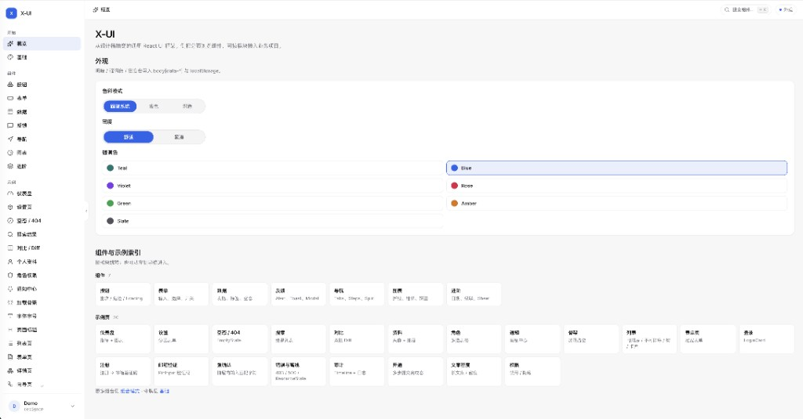

# x-ui

面向运维 / 控制台类产品的 React 设计系统与组件馆。本仓库既是可运行的组件文档站，也作为 npm 包 **`@shidudu2022/x-ui`** 供业务接入。

[](https://shidudu2022.github.io/x-ui/)

## 作为 npm 包安装

```bash
npm install @shidudu2022/x-ui
# peer: react / react-dom / react-router(-dom) ^19 / ^7
```

```tsx
import {
  AppShell,
  Button,
  AppearanceProvider,
  LocaleProvider,
} from '@shidudu2022/x-ui'
import '@shidudu2022/x-ui/styles.css'

export function App() {
  return (
    <LocaleProvider defaultLocale="en">
      <AppearanceProvider>{/* … */}</AppearanceProvider>
    </LocaleProvider>
  )
}
```

`LocaleProvider` 默认英文；`locale="zh"` 或 ThemeDrawer 中的 Language 可切换中文。组件内置文案（分页、确认、日历「今日」等）走 `useT()` / `useLocale()`。

本地构建库产物：`npm run build:lib`（输出 `dist/`）。发布：`npm publish --access public`。

## 文档站开发

```bash
pnpm install   # 或 npm / yarn
pnpm dev
```

浏览器打开提示的本地地址。文档站结构：

| 分区 | 内容 |
|------|------|
| 开始 | 概览 · 快速开始 · 设计令牌 · 主题与外观 · 开发约定 |
| 组件 | 全部组件索引 + 9 个分类（布局与排版 / 通用 / 表单 / 数据展示 / 图表 / 反馈 / 浮层与确认 / 导航与步骤 / 应用壳与账户）；每个组件页含引入、使用场景、可交互示例（带源码）、API、相关组件 |
| 页面模板 | 模板总览（30 个整页示例，5 组）· 组合模式 |

⌘K 可搜索组件（含分类）、文档与模板。

## 在线预览（GitHub Pages）

推送到 `main` 后，Actions（`.github/workflows/pages.yml`）会构建静态站并部署：

**https://shidudu2022.github.io/x-ui/**

首次需在仓库 **Settings → Pages → Source** 选 **GitHub Actions**。本地模拟：

```bash
npm run preview:pages
# 打开 http://localhost:4173/x-ui/
```

`build:pages` 使用 `VITE_BASE=/x-ui/`，并写入 SPA 回退（`scripts/spa-github-pages.mjs`）。业务资源路径用 `@/lib/baseUrl` 的 `withBase()`。

## 页面模板

| 场景 | 路径 | 要点 |
|------|------|------|
| 仪表盘 | `/examples/dashboard` | Metric/Stat + Chart |
| 列表 | `/examples/list` | 多模板，见下表 |
| 列表详情 | `/examples/list-detail` | 点「详情」拉出 Drawer 摘要 |
| 表单 | `/examples/form` | `page-narrow` + Field |
| 设置 | `/examples/settings` | SettingsRow + DangerZone + AccentPicker |
| 登录 | `/examples/login` | LoginCard + TotpBindPanel（本地 QR） |
| 注册 | `/examples/register` | 注册表单 → 跳转邮箱验证 |
| 邮箱验证 | `/examples/verify-email` | PinInput + 重发倒计时（演示码 `123456`） |
| 强确认 | `/examples/strong-confirm` | 按钮 → Drawer，输入匹配字符串后确认 |
| 向导 | `/examples/wizard` | Steps |
| 开通 | `/examples/onboarding` | 多步提交完成态 |
| 搜索 | `/examples/search` | SearchResultList |
| 页头 | `/examples/page` | PageHeader `actionItems` / overflow |
| 详情 | `/examples/detail` | PageTabs；右侧操作可收进「更多」 |
| 错误 | `/examples/errors` | 403 / 500 / 离线 / FormErrors |
| 审计 | `/examples/audit` | Timeline + DescriptionList + 日志 |
| 文案 | `/examples/i18n` | 长文案、密度 |
| 权限 | `/examples/permissions` | 禁用 / 隐藏策略 |
| 重置密码 | `/examples/reset-password` | 发重置链接 |
| 邀请成员 | `/examples/invite` | TagsInput + 角色 |
| API Key | `/examples/api-keys` | ResourceList + Drawer + Copy |

### 列表模板（`/examples/list?tpl=`）

| `tpl` | 说明 |
|-------|------|
| `sortable` | 可排序表格（默认） |
| `static` | 不可排序表格 |
| `pinned` | 左固定名称 + 右固定操作；多选时勾选列自动一并固定 |
| `tree` | 树表（`getChildren` / TreeTableCell） |
| `cards` | 卡片列表 |
| `compact` | 紧凑密度表格 |
| `resource` | ResourceList（筛选 + 表 + 分页一体） |

组件文档：`/components`（按分类）· `/components/<slug>` 单组件 · 模板总览：`/templates` · 组合：`/patterns`

待补页面示例：账单订单、文件管理、Webhook、定时任务、告警规则、导入导出、多租户切换。

## 表格固定列

`Table` / `DataTable` 列设 `pinned: 'left' | 'right'`：

- 横向滚动时 sticky；背景不透明，避免内容穿透
- 有左侧固定列且开启多选时，`__select` 勾选列会自动左固定并计入偏移
- 最外侧固定列用边框分隔（`is-pinned-edge`），无阴影
- 未设 `width` 的固定列（如操作列）按内容自适应；需要锁宽时再显式传 `width`

```tsx
columns={[
  { key: 'name', header: '名称', pinned: 'left', width: 180 },
  { key: 'status', header: '状态' },
  { key: 'actions', header: '', pinned: 'right', width: 96 },
]}
```

## 近期能力

### 组件增强

| 项 | 说明 |
|----|------|
| Sidebar / AppShell | `navGroups` 支持 `section` 分区标题、`collapsible` 可折叠分组（含当前路由自动展开，图标栏模式下降级为分组图标） |
| Select | 选项搜索；窄屏/触控可回退原生 `<select>` |
| DataTable | `remote`；`hideFooter` / `hideHeader`；`columnVisibility`；`resizableColumns`；`pinned` |
| Table | sticky 固定列 + 边缘边框；多选与左固定联动 |
| Drawer | `size` sm\|md\|lg\|xl；`usePresence` 滑动进场 |
| DatePicker | `minuteStep` / `disabledDate`；范围双月；datetime：日历\|日历\|开始\|结束 |
| Toast | `info` \| `success` \| `warn` \| `error` |
| Tree / Transfer | `searchable` |
| FileUpload | 进度、`maxSizeMb` |
| CommandPalette | 最近使用、异步查询 |
| Tooltip / Popover | 视口碰撞；Tooltip 长按 |
| PageHeader | `actionItems`（`overflow`）收进「更多」；主按钮保持 `md` |
| ColorInput | 自定义 HSV 面板（非原生 `type=color`） |
| ImagePreview | `withBase` 资源；本地 demo 图 |

### 新增组件

`TimePicker` · `PageTabs` · `StatCard` · `ResourceState` · `ImagePreview` · `ColorInput` · `JsonViewer` · `KeyValueEditor` · `SearchResultList` · `SettingsRow` / `DangerZone` · `AccentPicker` · `Stack` / `FormGrid` / `CatalogTile` · `TotpBindPanel` · `TreeTableCell`

> 仍按需：Mention / 轻量 RichText；虚拟长列表；Playwright 视觉回归；可选 npm 包形态。

## AI 使用规范

Cursor Agent 请加载：

```text
.cursor/skills/x-ui/SKILL.md
```

组件导出名、**示例页面索引**与文档站数据源（分类 / 目录 / 模板）见 `.cursor/skills/x-ui/reference.md`。

**示例优先**：实现页面前先按 Skill 里「场景 → 示例」表打开 `src/demo/pages/...` 对照，再按同样组件与校验方式实现（登录对照 `ExampleLoginPage`，强确认抽屉对照 `ExampleStrongConfirmPage`，列表对照 `list/*Template`）。

约定摘要：只用现有组件与 CSS 变量；不要引入 Tailwind；图表用 `CHART_STATUS`；布局优先 `AppShell` / `PageHeader` / `page-narrow`；强确认用 `StrongConfirm` / `StrongConfirmDrawer`；日期用弹层 DatePicker；颜色用 `ColorInput`；控件字号 `--control-fs`（13px）。

## 技术栈

- Vite 8 + React 19 + TypeScript + React Router 7
- 样式：原生 CSS + `@layer` + CSS 变量（非 Tailwind）
- 图标：`lucide-react`
- 图表：`recharts`
- 二维码：`uqr`（TOTP 绑定）

## License

Private / 按仓库约定。
